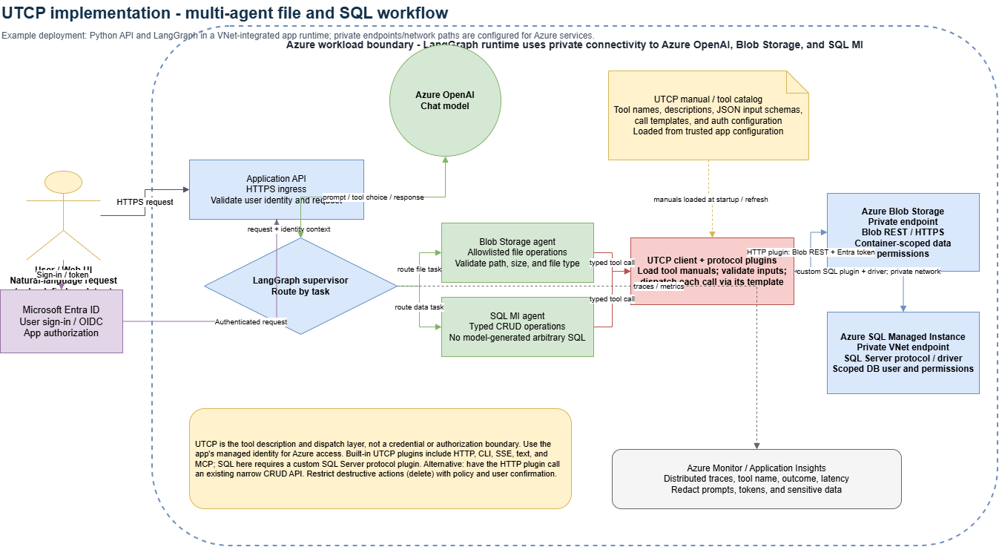
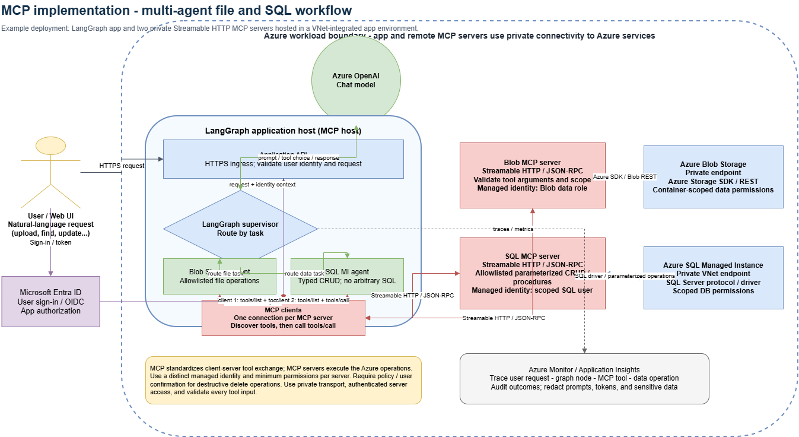

# Azure UTCP and MCP multi-agent examples

This project compares two ways to connect a LangGraph multi-agent application
to Azure services. Both examples use an Azure OpenAI model, a Blob Storage
agent for file operations, and a SQL agent for CRUD (create, read, update, and
delete) operations against Azure SQL Managed Instance.

## What is UTCP?

The [Universal Tool Calling Protocol (UTCP)](https://www.utcp.io/) describes
tools in a **manual**: their names, descriptions, input schemas, and call
templates. A UTCP client reads that manual and uses the appropriate protocol
plugin to invoke the tool. A tool can use its existing interface, such as an
HTTP API, without necessarily adding a separate wrapper server. UTCP can also
connect to MCP servers through its MCP plugin.

UTCP (Universal Tool Calling Protocol) is an open-source, lightweight standard designed to let AI agents discover and call external tools directly using their native protocols (such as HTTP, CLI, WebSockets, or GraphQL) without needing dedicated wrapper servers or middleman proxies.

Its core philosophy is: "If a human can call your API, an AI agent should be able to call it too—with the same security and no additional infrastructure."

**How UTCP Works**
Instead of routing tool requests through an intermediary server that translates messages, UTCP acts like a standardized instruction manual:

Discovery: An agent fetches a UTCP Manual (a JSON document describing available tools, input/output schemas, authentication requirements, and connection details). Existing REST APIs can also auto-generate manuals from OpenAPI specs.

Direct Calling: Once the agent reads the manual, it communicates directly with the tool's native endpoint (e.g., sending a standard GET/POST request to a REST API or running a local CLI command).

Native Response: The tool processes the request and returns its normal output directly to the agent.

**Key Features & Benefits**
Zero "Wrapper Tax": You don't have to build, host, or maintain separate adapter servers for every tool or API you want an agent to use.

Lower Latency: Direct peer-to-peer communication removes the extra network hops introduced by proxy servers.

Native Security & Auth: Tools retain their existing authentication, rate-limiting, and billing mechanisms (API keys, OAuth, etc.) rather than reimplementing security in a wrapper layer.

Multi-Protocol Plugin Architecture: Supports HTTP/REST, Server-Sent Events (SSE), WebSockets, Command-Line Interfaces (CLI), local text files, and even interoperability with MCP via dedicated plugins.


## What is MCP?

The [Model Context Protocol (MCP)](https://modelcontextprotocol.io/introduction)
is a client-server protocol for connecting AI applications to external tools,
data, and workflows. An MCP host creates clients that discover and call tools
exposed by MCP servers. The server implements the tool or connects to an
underlying service. MCP also defines primitives for resources and prompts.

## UTCP vs. MCP

The main difference is the tool invocation path: **UTCP describes how to
invoke a tool through a supported protocol; MCP standardizes communication
between an MCP client and server.**

| Aspect | UTCP | MCP |
| --- | --- | --- |
| Discovery | A manual describes tools and call templates. | A client discovers capabilities and tools from a server. |
| Invocation | A protocol plugin invokes the tool using its configured interface. | A client sends an MCP tool call to a server, which executes the operation. |
| Integration | Can reuse native interfaces and avoid an additional wrapper server; custom plugins may be needed. | Requires an MCP server for the exposed integration; the server can be local or remote. |
| Scope | Tool descriptions and calls across supported protocols. | Standard client-server exchange of tools, resources, prompts, and other capabilities. |
| Transports | Depends on installed plugins, such as HTTP, CLI, or MCP. | Standard transports include stdio and Streamable HTTP. |
| In this project | An in-process UTCP client uses a custom Azure SDK/SQL driver plugin. | Two local MCP servers expose Blob and SQL tools over stdio. |
| Security | Authentication and authorization depend on the target service, client, and plugin. | Authentication and authorization depend on the host, server, transport, and target service. |
| Interoperability | Can call MCP tools using the UTCP MCP plugin. | Can serve existing MCP clients; it does not require UTCP. |

Neither protocol alone grants Azure permissions or makes agent actions safe;
authorization, input validation, and operational safeguards remain necessary.

## Use case and shared workflow

1. A user provides a natural-language request to the Python command-line app.
2. The LangGraph supervisor uses an Azure OpenAI model to choose the Blob
   agent, the SQL agent, or both, and decides their execution order.
3. Each specialist uses the model and its own allowlisted tools to handle its
   part of the request. When both agents are selected, the next agent receives
   the previous agent's result as context.
4. The selected tools access Azure Blob Storage or SQL Managed Instance and
   return results to the agent. The application displays the agent results.

| Agent | Operations in this example | Target and constraints |
| --- | --- | --- |
| Blob Storage | List, read, create, and delete blobs | One configured container; UTF-8 text; no overwrite; read/write limit of 256 KiB; list limit of 100 names. |
| SQL MI | Create, read, update, and delete records | One fixed `dbo.AgentRecords` table, using parameterized SQL and exact record IDs. |

The application uses `DefaultAzureCredential` for Azure OpenAI, Blob
Storage, and SQL access. It does not create Azure resources, the container,
database, table, or role assignments.

### UTCP implementation



[Open UTCP diagram image](images/utcp.png) |
[Edit UTCP draw.io diagram](docs/utcp.drawio)

In [utcp.py](utcp.py), the application registers an in-process UTCP manual
containing the Blob and SQL tools. LangGraph tools invoke the UTCP client,
which dispatches calls through a **custom `azure_sdk` protocol plugin**. The
plugin calls the Azure Blob SDK or SQL Server ODBC driver directly; it is not
a built-in UTCP SQL transport.

```text
User -> LangGraph supervisor -> Blob/SQL agent -> UTCP client
     -> custom Azure SDK plugin -> Blob Storage / SQL Managed Instance
```

The diagram illustrates an HTTP plugin for Blob Storage and a custom SQL
plugin. The runnable code instead uses the custom SDK plugin for both.

### MCP implementation



[Open MCP diagram image](images/mcp.png) |
[Edit MCP draw.io diagram](docs/mcp.drawio)

In [mcp.py](mcp.py), the host starts a Blob MCP server and a SQL MCP server as
local child processes. It opens an MCP client session to each server, discovers
the tool lists, and sends the selected tool call to the appropriate server.
The servers use the shared Azure operations and workflow code from
[utcp.py](utcp.py); MCP calls do not pass through a UTCP client.

```text
User -> LangGraph supervisor -> Blob/SQL agent -> MCP client
     -> Blob/SQL MCP server -> Blob Storage / SQL Managed Instance
```

The diagram shows remote Streamable HTTP servers and separate managed
identities as an architectural option. The runnable example uses local stdio
servers, inherits the environment, and does not configure remote authentication,
TLS, or separate identities.

## Prerequisites

- Python 3.12 and Microsoft ODBC Driver 18 for SQL Server.
- An Azure OpenAI model deployment supporting tool calling and structured
  outputs.
- An existing Storage account and container, and an existing SQL Managed
  Instance database reachable through the appropriate network and DNS.
- `DefaultAzureCredential` authentication: sign in with `az login` for local
  development or configure managed identity for Azure. Grant the identity
  access to the Azure OpenAI deployment, the configured container, and the
  SQL database. SQL permissions should be restricted to the sample table and
  only the operations needed.

Install dependencies into a virtual environment:

```powershell
py -3.12 -m venv .venv
.\.venv\Scripts\python.exe -m pip install -r requirements.txt
```

In the target SQL database, have an authorized administrator review and
provision this example table before using the SQL agent. The application does
not create the table or grant permissions.

```sql
CREATE TABLE dbo.AgentRecords (
    id nvarchar(100) NOT NULL PRIMARY KEY,
    content nvarchar(4000) NOT NULL
);
```

Set these environment variables for your resources:

```powershell
$env:AZURE_OPENAI_ENDPOINT = "https://YOUR-RESOURCE.openai.azure.com/"
$env:AZURE_OPENAI_DEPLOYMENT = "YOUR-DEPLOYMENT"
$env:AZURE_OPENAI_API_VERSION = "YOUR-SUPPORTED-API-VERSION"
$env:AZURE_STORAGE_ACCOUNT_URL = "https://YOUR-ACCOUNT.blob.core.windows.net"
$env:AZURE_STORAGE_CONTAINER = "YOUR-CONTAINER"
$env:AZURE_SQL_SERVER = "YOUR-MANAGED-INSTANCE-FQDN"
$env:AZURE_SQL_DATABASE = "YOUR-DATABASE"
```

Set `AZURE_SQL_ODBC_DRIVER` only if a different compatible driver is required.
`AZURE_CLIENT_ID` can select a user-assigned managed identity through
`DefaultAzureCredential`.

## Run the UTCP example

```powershell
.\.venv\Scripts\python.exe .\utcp.py "List the files under reports/"
.\.venv\Scripts\python.exe .\utcp.py "Read database record with ID 123"
.\.venv\Scripts\python.exe .\utcp.py "Create record 123 with content hello"
```

## Run the MCP example

Use the same prerequisites, environment variables, and sample SQL table:

```powershell
.\.venv\Scripts\python.exe .\mcp.py "List the files under reports/"
.\.venv\Scripts\python.exe .\mcp.py "Read database record with ID 123"
.\.venv\Scripts\python.exe .\mcp.py "Create record 123 with content hello"
```

The MCP host starts and stops the server processes automatically. Each child
inherits the local environment and uses `DefaultAzureCredential`.

For MCP, confirmation is enforced by this local host before each mutation,
not by the server. An independently launched server or different MCP client
can bypass that confirmation. Do not expose these servers to untrusted clients;
production servers need their own authentication, authorization, approval
enforcement, and isolated identities.

The SQL table name and fields are fixed in the example: requests cannot choose
arbitrary SQL or tables. Blob creation never overwrites existing objects; text
uploads and reads are limited to 256 KiB and listings to 100 names.

Every create, update, and delete is denied without an interactive terminal.
For each mutation the exact arguments are displayed and the operator must type
`YES`. The application uses one Azure identity, not per-user authorization;
the confirmation is a local demonstration guard, not a production approval
system. The model can see requests and tool results, so do not use confidential
data unless the deployment and data handling are appropriate. Prompt injection,
multi-user access control, data classification, audit logging, durable state,
and network isolation require additional production controls.

Azure and tool failures are returned as errors rather than successful tool
results. The agents execute in the order selected by the supervisor. Operations
across Blob Storage and SQL are not atomic.

## Test

```powershell
.\.venv\Scripts\python.exe -m unittest discover -s tests -v
```

The tests use mocks for Azure resources and do not replace a live integration
test against your own account and managed instance.

## References

- [UTCP documentation](https://www.utcp.io/)
- [MCP introduction](https://modelcontextprotocol.io/introduction)
- [LangGraph documentation](https://docs.langchain.com/oss/python/langgraph/overview)
- [Azure SQL Managed Instance connectivity](https://learn.microsoft.com/azure/azure-sql/managed-instance/connect-application-instance)
